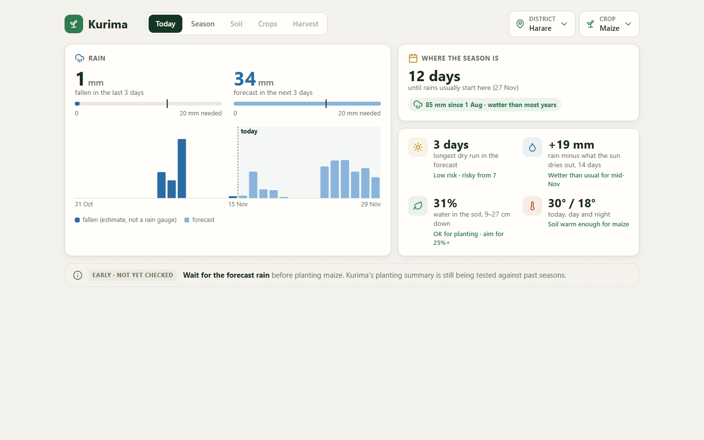

# Kurima plan

> **Status: draft.** Replaces [BUILD-ORDER.md](BUILD-ORDER.md) and [ROADMAP.md](ROADMAP.md), which are kept for reference only. Expect this plan to change as work goes on.
>
> The aim: **give farmers weather and season data that means something to them, so they can decide when to plant.**
> Milestones are listed in the order they're built. Inside each milestone, **backend versions come first, then one UI version** that connects the new work to the screen.

**Work types:** bug fix · code change · new function · new screen/component · data · test · docs

## Standing notes

- **Data first, planting suggestion last.** A "good time to plant" suggestion only comes in Milestone 8, once the weather, soil and crop data under it are solid and checked. Until then a suggestion would be a guess.
- **Vercel deploys are always done by hand, by Michelle.** No version waits on a deploy.
- **Agronomy numbers** (days to maturity, per-crop needs) come from AREX or an agronomist. Until then they're shown as provisional.
- **No screenshots in the README** while the UI is changing this much.

---

## How hard each part is

**Easy:** small, contained change; little risk. **Medium:** several files or a new function with tests. **Hard:** new system, new data source, or design work that needs several rounds.

| Milestone | Overall | Hardest part |
|---|---|---|
| 1 · Clear weather and season info | Medium | 1.3, the Today redesign (design rounds) |
| 2 · Check against past seasons | Hard | 2.1, building the simulator |
| 3 · Soil and what to buy | Medium | 3.2, finding reliable fertiliser and price data |
| 4 · Crops and pests | Medium, plus waiting on agronomy numbers | 4.1, per-crop rules |
| 5 · Storage and selling | Medium | 5.2, a market price source |
| 6 · Grow across Africa | Medium | 6.3, two rainy seasons in one year |
| 7 · Usable for everyone | Hard | 7.4 and 7.5, SMS/WhatsApp and a mobile app |
| 8 · Suggest when to plant | Medium | 8.1, combining everything into one suggestion |

---

## UI standards (apply to every UI version)

Every UI version must meet all of these. A UI version isn't done until Michelle has looked at the screenshots and agreed.

**Looks**
- Desktop-first: designed at 1440 × 900, still works at 390 wide (phone). No sideways scrolling.
- One clear focal point per screen. The most important number is the biggest thing on the screen.
- Data first: numbers, charts and comparisons lead. Any planting summary is secondary until Milestone 8.
- Icons or small graphics next to each figure (`lucide-react`, already installed), so the screen isn't a wall of text.
- Cards of the same kind are the same size and line up in a grid. No single card left alone on its own row.

**Readability**
- No text smaller than 13 px, including chart axis labels.
- Every number has a label in plain words and what it's compared against.
- Contrast meets WCAG AA (4.5:1 for text) in all 4 themes.
- Short sentences; at most 2 lines of explanation under a card. More goes behind tap-to-explain.

**Behaviour**
- Changing district or crop updates in place, without leaving the screen.
- Only one tap-to-explain panel open at a time.
- Anything loading shows a loading state; anything missing says "unknown", never 0.

**How each UI version is checked**
- Screenshots at 1440 × 900 and 390 × 844 for every screen it touched, in the default theme and "Bright sun".
- An e2e test for each new interaction.
- Michelle reviews the screenshots before the version is ticked.

### What the UI looks like now (checked 15 Nov at 1440 and 390 wide)

- **Today, laptop:** fits on one screen. The planting summary ("Wait before planting maize") is the biggest thing, so the data is secondary, which is the opposite of the plan.
- **Stat tiles:** 4 tiles in a row and a 5th ("31% water deeper down") alone on a second row. Labels like "rain minus what the sun takes" are hard to read at a glance.
- **Charts:** axis labels on the rain chart and season curves are about 8 px, too small to read.
- **Selected tab:** its label is nearly invisible (dark on dark green).
- **Phone:** the nav wraps into two rows (tabs, then Settings and About), and Today is about twice the screen height.
- **Placeholder tabs** (Soil, Crops, Harvest): a single dashed card on an empty page; Soil says "Milestone 2", which doesn't match this plan.
- **Wording:** the header says "Planting guidance" and the first screen promises "whether this is a good time to plant".

---

## Where Kurima is now

| Milestone | Progress | What exists | What's missing |
| --- | --- | --- | --- |
| 1 · Weather and season info | ~70% | Current rain, forecast, water balance, soil temperature and moisture; when rains usually start; this season against past seasons; climate packs for 8 districts; the new UI | The fixes in 1.0–1.1; plain-language numbers (1.2–1.3) |
| 2 · Check against past seasons | ~15% | 35 years of weather for 16 places in `data/simulator/`; a small backtest of 116 onset events (`src/lib/backtest.test.ts`) | The full simulator and acting on it |
| 3 · Soil and what to buy | 0% | Placeholder Soil tab | Everything |
| 4 · Crops and pests | ~5% | Crop menu; crop tracking after planting (both maize-only underneath) | Per-crop rules, guides, pests |
| 5 · Storage and selling | 0% | Placeholder Harvest tab | Everything |
| 6 · Grow across Africa | ~20% | "Checked" vs "weather only" labels; logic tested on Sahel, two-season and very dry climates | More places, search, country presets |
| 7 · Usable for everyone | ~5% | 4 themes, including a high-contrast "Bright sun" one | Languages, low-data mode, accessibility, sharing beyond the web app |
| 8 · Suggest when to plant | early, not trusted | A plant / wait / too dry summary on the Today screen, checked only by the small backtest | Everything in Milestones 1–4 |

**Tests:** 161 unit and 38 end-to-end at last count, CI, no lint warnings. The live Vercel site still shows an old version.

---

## Milestone 1 · Build clear weather and season info for planting

**What farmers get:** for their district, today's rain and forecast, soil temperature and moisture, how this season compares to past ones, and when the rains usually start, each explained in plain words.

### 1.0 Fix bugs

**Difficulty:** Medium

**First:** go through the app and code for any bugs beyond these, and add them here before fixing anything. Only bugs in what exists now.

| Done | # | Bug | Type | What changes |
| --- | --- | --- | --- | --- |
| [ ] | 1 | Says "Good time to plant maize" in March | bug fix + new function | New function: latest safe planting date = when rains usually end − days to maturity. After that date the summary says "too late". Test: March says too late, November doesn't |
| [ ] | 2 | Picking sorghum only changes the label | bug fix | For crops other than maize, say the numbers use maize's needs. Test |
| [ ] | 3 | First run highlights the Today tab before a place is picked | bug fix | No tab active until a place is chosen. e2e test |
| [ ] | 4 | README shows screenshots of an old app | docs | Remove the screenshots; keep the text current |
| [ ] | 5 | Possibly: recent-rain numbers on Today may not treat a missing day as unknown | check, fix if so | Confirm it goes through `src/lib/series.ts`. Test with a gap |
| [ ] | 6 | The selected tab's label is almost invisible (dark text on dark green) | bug fix | Light text on the active tab, meeting contrast in all 4 themes |
| [ ] | 7 | Placeholder tabs name the wrong milestone (Soil says "Milestone 2") | bug fix | Match this plan's numbering, or drop the milestone from the label |
| [ ] | 8 | Header and first-run text promise "whether this is a good time to plant" | docs/code change | Describe what Kurima shows (rain, forecast, season), not a planting decision, until Milestone 8 |

### 1.1 Reorganise the code, with no visible change *(backend)*

**Difficulty:** Medium

| Done | Change | Type |
| --- | --- | --- |
| [ ] | Move all on-screen text into one strings file | code change |
| [ ] | Split the 557-line stylesheet by screen | code change |
| [ ] | Show "unknown" instead of a fake 0 | bug fix |
| [ ] | One way to calculate "drier than X% of seasons" | code change |

- [ ] **Done when:** the app looks and behaves the same and all tests pass.

### 1.2 Data behind understandable numbers *(backend)*

**Difficulty:** Medium

| Done | Change | Type |
| --- | --- | --- |
| [ ] | Every figure comes with what it's compared against (its threshold or its usual range for that date) | new function |
| [ ] | Water balance compared with the same days in past seasons ("normal" or "drier than usual") | new function |
| [ ] | Soil moisture gets a threshold that means something, or is dropped | decision + code change |
| [ ] | Dry-spell warning from the forecast, separate from any planting summary | new function |
| [ ] | Store each day's reading on the device from now on, so looking back at past weather can also show what Kurima said that day (finishes look-back, which today shows weather only) | new function |

- [ ] **Done when:** every number the UI shows has a comparison or threshold available, with tests.

### 1.3 UI: make every number understandable *(frontend)*

**Difficulty:** Hard

| Done | Change | Type |
| --- | --- | --- |
| [ ] | Each number shown next to its comparison ("4 dry days, risky from 7") | code change |
| [ ] | Plain labels ("most rain in any 3 days", not "wettest recent spell (modelled)") | code change |
| [ ] | Tap-to-explain on the outlook, normals and rain chart (finishes tap-to-explain, which today is only on the signal card, season curves and crop tracking) | code change |
| [ ] | Dry-spell warning shown on Today | new component |
| [ ] | "Drier than 53%" reads as about average; outlook says what "normal" means | code change |
| [ ] | Plant / wait summary visibly marked as early and unchecked until Milestone 8 | code change |
| [ ] | Rebuild Today's layout around the data: rain fallen and coming, dry-spell risk and the season position lead; the planting summary becomes a smaller line | code change |
| [ ] | Stat tiles in an even grid (no tile alone on a row), each with an icon, plain label and comparison | code change |
| [ ] | Chart axis labels at least 13 px | code change |
| [ ] | Phone nav on one row (icons with short labels, Settings and About in a menu) | code change |
| [ ] | Placeholder tabs show what's coming with a simple illustration, not a lone dashed card | code change |

**Mockups: three directions for Today** (pick one, or mix; the chosen one becomes a clickable prototype before any code is written)

| | Laptop | Phone |
|---|---|---|
| **A · Data cards:** rain card with "needed" bars and chart on the left; season and four stats on the right | [desktop](docs/sketches/1.3-today-a-desktop.png) | [phone](docs/sketches/1.3-today-a-phone.png) |
| **B · Chart first:** one wide rain chart across the top, four stat cards below, season underneath | [desktop](docs/sketches/1.3-today-b-desktop.png) | [phone](docs/sketches/1.3-today-b-phone.png) |
| **C · Season first:** a timeline from August to March showing where today sits and when rains usually start, then this week's rain and the stats | [desktop](docs/sketches/1.3-today-c-desktop.png) | [phone](docs/sketches/1.3-today-c-phone.png) |

Source for all three: [docs/sketches/today-variants.html](docs/sketches/today-variants.html) (open in a browser with `?v=a`, `b` or `c`, and `&w=phone`). Numbers are Harare on 15 Nov from the live app.

- [ ] **Done when:** someone who has never used Kurima can say what each number on the Today and Season screens means, every item in the UI standards is met, and Michelle has approved the screenshots.

---

## Milestone 2 · Check the weather info against 35 years of real seasons

### Why a simulator

Nobody yet knows how often Kurima's readings are right, and waiting for real seasons would take years. The simulator uses the 35 years of weather already downloaded: it pretends it's each morning of each past season, runs Kurima's real code on only the weather known that morning, then checks what the weather did next. That gives a real track record, and a test that shows whether a rule change made things better or worse.

**Known limit:** past forecasts weren't stored, so the replay uses what actually happened as the "forecast". Results will look better than real life, and that has to be stated alongside them.

### 2.1 Build the simulator *(backend)*

**Difficulty:** Hard

| Done | Part | Type |
| --- | --- | --- |
| [ ] | Replay each morning with only the data known that day | new function |
| [ ] | Judge what happened next (damaging dry spell? good rain missed?) | new function |
| [ ] | Compare with the farmer habit "plant on the first big storm" | new function |
| [ ] | Command that prints results per place | new script |
| [ ] | Fail CI if results get worse | test |
| [ ] | Retire the small backtest once the simulator covers it | code change |

### 2.2 Fix what the simulator shows is weak *(backend)*

**Difficulty:** Medium

| Done | Change | Type |
| --- | --- | --- |
| [ ] | Adjust the rules where results are worst | code change |
| [ ] | Give "drier than normal" a real likelihood | new function |
| [ ] | Work out when the data might next change ("check again Thursday") | new function |

### 2.3 UI: show the track record *(frontend)*

**Difficulty:** Medium

| Done | Change | Type |
| --- | --- | --- |
| [ ] | "How reliable is this?" per place, from the simulator | new component |
| [ ] | Outlook shows its checked likelihood | code change |
| [ ] | "Check again on …" on Today | new component |

**Mockup, track record on Today:** to come, in the style picked for Today.

- [ ] **Done when:** a farmer can see, for their place, how often the numbers matched what happened, with the limit stated.

---

## Milestone 3 · Expand to soil data and what to buy

| Done | Version | Work | Type | Difficulty |
| --- | --- | --- | --- | --- |
| [ ] | 3.1 *(backend)* | Soil data for each place: pH, texture | data (e.g. iSDAsoil or SoilGrids) + new function | Medium |
| [ ] | 3.2 *(backend)* | Fertiliser and seed guidance from national recommendations; cost against likely yield and price | data + new function | Medium |
| [ ] | 3.3 *(UI)* | Soil tab replaces its placeholder: what your soil is, what it means, what to buy | new screen; update About | Medium |

**Mockup, Soil tab:** to come, in the style picked for Today.

- [ ] **Done when:** the Soil tab answers "what is my soil and what should I buy".

## Milestone 4 · Add crop-specific info and pest help

| Done | Version | Work | Type | Difficulty |
| --- | --- | --- | --- | --- |
| [ ] | 4.1 *(backend)* | Separate rules per crop (needs agronomy numbers); crop tracking uses the chosen crop's thresholds, not maize's for every crop (finishes crop choice and crop tracking) | data + code change | Medium |
| [ ] | 4.2 *(backend)* | Latest safe planting date per crop and district, with source | new function (builds on 1.0 bug 1) | Easy |
| [ ] | 4.3 *(backend)* | Offline pest data for maize (fall armyworm first) | data, cached for offline | Medium |
| [ ] | 4.4 *(UI)* | Crops tab replaces its placeholder: crop guides, whether a crop can finish before the rains end, pest guide | new screen; update About | Medium |

**Mockup, Crops tab:** to come, in the style picked for Today.

- [ ] **Done when:** changing the crop changes the numbers, not just the label.

## Milestone 5 · Support storage and selling

| Done | Version | Work | Type | Difficulty |
| --- | --- | --- | --- | --- |
| [ ] | 5.1 *(backend)* | Drying and storage checklists with reminders | data + new function | Easy |
| [ ] | 5.2 *(backend)* | Market prices, sell now or store | data (price source) + new function | Medium |
| [ ] | 5.3 *(UI)* | Harvest tab replaces its placeholder | new screen; update About | Medium |

**Mockup, Harvest tab:** to come, in the style picked for Today.

- [ ] **Done when:** the Harvest tab is worth opening in May.

## Milestone 6 · Grow across Africa

**What farmers get:** Kurima for any place in Africa, with a clear note of how much it knows there.

| Done | Version | Work | Type | Difficulty |
| --- | --- | --- | --- | --- |
| [ ] | 6.1 *(backend)* | Climate packs for all Zimbabwe districts | data | Easy |
| [ ] | 6.2 *(backend)* | Neighbouring one-season countries (Malawi, Zambia, Mozambique) | data + country presets | Medium |
| [ ] | 6.3 *(backend)* | Two-season climates (East Africa) | code change | Medium |
| [ ] | 6.4 *(backend)* | West Africa and the Sahel | data + presets | Medium |
| [ ] | 6.5 *(UI)* | Place search anywhere in Africa, with "checked" vs "weather only" for every place | code change | Medium |

**Mockup, place search:** to come, in the style picked for Today.

- [ ] **Done when:** a farmer anywhere in Africa can pick their place and is told plainly how much Kurima knows there.

## Milestone 7 · Make it usable for everyone

| Done | Version | Work | Type | Difficulty |
| --- | --- | --- | --- | --- |
| [ ] | 7.1 *(backend)* | Shona and Ndebele translations | data into the strings file from 1.1 | Medium |
| [ ] | 7.2 *(backend)* | Low-data mode | code change + caching | Medium |
| [ ] | 7.3 *(UI)* | Language switch, accessibility (screen readers, contrast check for each of the 4 existing themes, text size) | code change across components + tests | Medium |
| [ ] | 7.4 | Reach farmers without smartphones: a short daily summary by SMS or WhatsApp | new service | Hard |
| [ ] | 7.5 | Mobile app | new project wrapping the web app | Hard |

**Mockup, settings:** to come, in the style picked for Today.

- [ ] **Done when:** a farmer can use Kurima in Shona on a low-end phone with little data, and the screen reader reads every card.

## Milestone 8 · Suggest when to plant

**What farmers get:** a "good time to plant" suggestion for their crop and place, built on checked data.

**Why last:** it needs the weather info clear (1), checked against past seasons (2), the soil known (3) and the crop's own needs (4).

| Done | Version | Work | Type | Difficulty |
| --- | --- | --- | --- | --- |
| [ ] | 8.1 *(backend)* | Combine rain, soil moisture and temperature, soil type and the crop's needs into one suggestion | code change (replaces today's early summary) | Medium |
| [ ] | 8.2 *(backend)* | Measure the suggestion with the simulator | code change | Easy |
| [ ] | 8.3 *(UI)* | Show the suggestion with its track record, and say plainly when Kurima isn't sure enough to suggest anything | code change | Medium |

**Mockup, planting suggestion:** to come, in the style picked for Today.

- [ ] **Done when:** the suggestion names its crop and place, shows its track record, and stays silent when the data isn't good enough.
