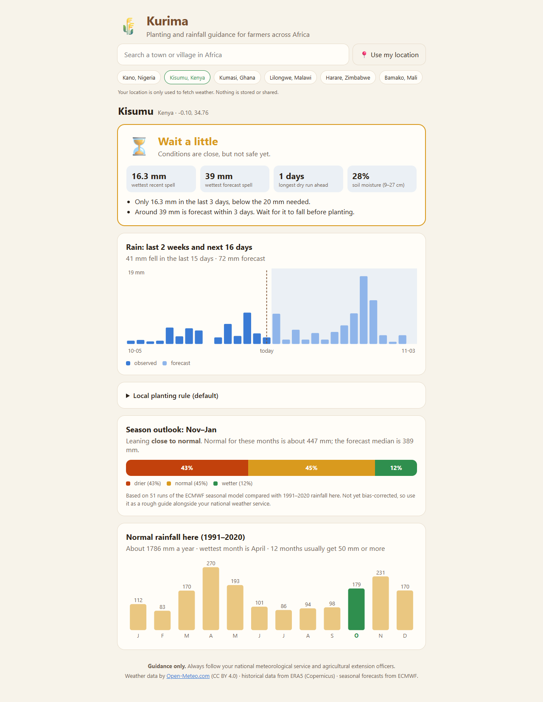
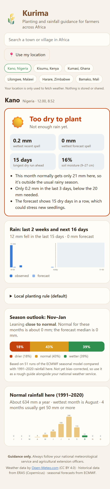

# Kurima 🌾

**Should I plant yet?** Rainfall, forecasts and season outlooks for farmers anywhere in Africa.

*Kurima* means "farming" in Shona.

**▶ Live demo: [kurima-six.vercel.app](https://kurima-six.vercel.app)** (no sign-up; pick a town)

<p align="center">
  
  
</p>

Rainy seasons across Africa are getting harder to read: rains start late, false starts tempt farmers to plant too early, and long dry spells kill seedlings. Seasonal outlooks exist, but they rarely reach farmers in a form they can act on for their own village.

Kurima turns free satellite and weather-model data into plain guidance for one location:

| | What you see | Data |
|---|---|---|
| 🌱 **Plant-or-wait signal** | Plant, wait or too dry, with the reasons, based on recent rain, the 16-day forecast and dry spells ahead | Open-Meteo forecast |
| 🌧️ **Rain: last 2 weeks + next 16 days** | Daily bars, recent (modelled) vs forecast, soil moisture | Open-Meteo forecast (past days are archived model data, not rain gauges) |
| 📅 **Season outlook (next 3 months)** | Rough chance of a drier, normal or wetter season than usual (not yet calibrated) | ECMWF seasonal ensemble (51 runs) vs 1991–2020 history |
| 📊 **Normal rainfall here** | Average rain for every month, wettest month, length of the rainy season | ERA5 reanalysis, 1991–2020 |

**Who it's for:** smallholder farmers, extension officers and farmer groups who want a quick, local read on the season.

**Status:** early prototype (installable PWA). The core signal and climate maths have unit tests, but a review found accuracy issues to fix before anyone relies on it, and the first milestone narrows to rain-fed maize in selected Zimbabwean districts. See [ROADMAP.md](ROADMAP.md).

---

## No accounts, no personal data

Kurima has no login and no backend. You search for a town (or share your location once), and the app asks Open-Meteo for weather at those coordinates. Nothing is stored except a local cache of historical data in your own browser.

## The planting rule

By default Kurima treats the rains as started when **20 mm falls within 3 days** and the forecast shows **no dry spell of 7 days or more** afterwards, and only during months that normally get rain. Countries publish their own rules (Zimbabwe, for example, advises 20 mm over 3 days or 25 mm in a week), so every threshold can be changed in the app.

> **Guidance only.** Always follow your national meteorological service and agricultural extension officers.

---

## Built with

| | |
|---|---|
| App | React 19 + TypeScript + Vite |
| Offline | vite-plugin-pwa (service worker caches the app and recent weather) |
| Tests | Vitest |
| Data | [Open-Meteo](https://open-meteo.com/) forecast, historical (ERA5), seasonal (ECMWF) and geocoding APIs |

## Project structure

```
src/
├── lib/
│   ├── onset.ts        # Plant-or-wait signal (pure functions, tested)
│   ├── climate.ts      # Monthly normals, season totals, tercile outlook (tested)
│   └── openMeteo.ts    # API client: search, weather, history, seasonal
├── components/         # Search, signal card, rain chart, outlook, normals, rule settings
└── App.tsx
```

## Running locally

```bash
npm install
npm run dev      # http://localhost:5173
npm test         # unit tests
npm run build    # production build + service worker
```

No API keys are needed.

---

## Data credits

Weather data by [Open-Meteo.com](https://open-meteo.com/), licensed CC BY 4.0. Historical data from ERA5 (Copernicus Climate Change Service). Seasonal forecasts from ECMWF SEAS5. Open-Meteo's free API is for non-commercial use.

## License

[MIT](LICENSE) © 2026 Michelle Vava
