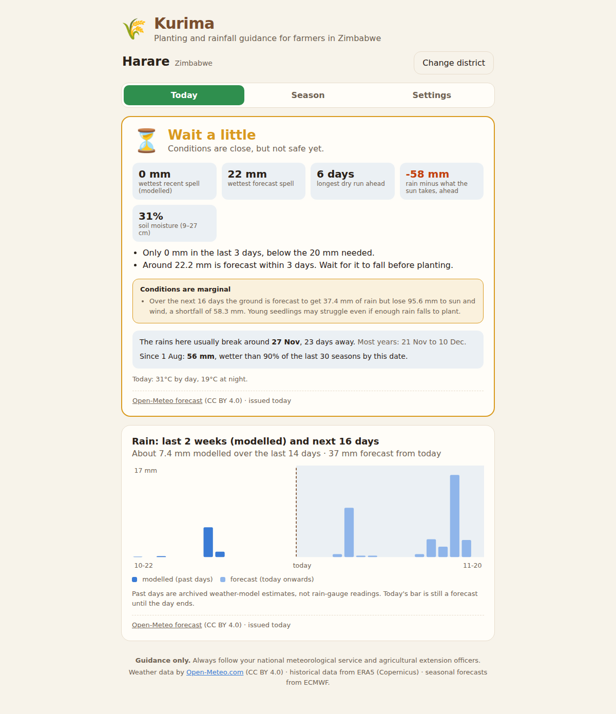
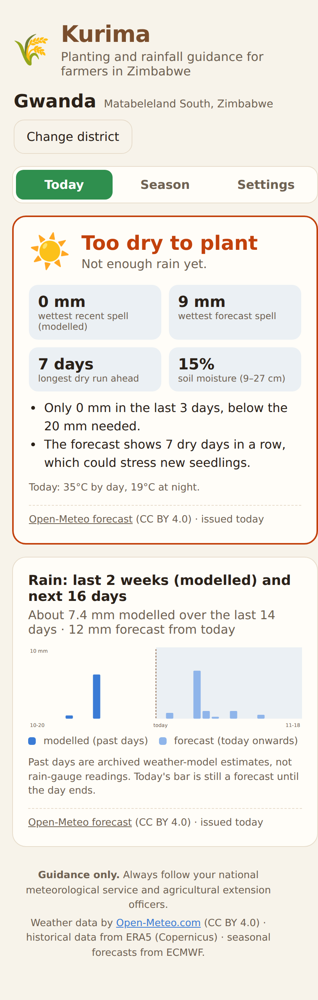

# Kurima 🌾

**Should I plant yet?** Rainfall, forecasts and season outlooks for farmers anywhere in Africa.

*Kurima* means "farming" in Shona.

**▶ Live demo: [kurima-six.vercel.app](https://kurima-six.vercel.app)** (no sign-up; pick a town)

<p align="center">
  
  
</p>

Rainy seasons across Africa are getting harder to read: rains start late, false starts tempt farmers to plant too early, and long dry spells kill seedlings. Seasonal outlooks exist, but they rarely reach farmers in a form they can act on for their own village.

Kurima turns free satellite and weather-model data into plain guidance for one location:

| | What you see | Data |
|---|---|---|
| 🌱 **Plant-or-wait signal** | Plant, wait or too dry, with the reasons, based on recent rain, the 16-day forecast and dry spells ahead | Open-Meteo forecast |
| 🌧️ **Rain: last 2 weeks + next 16 days** | Daily bars, recent (modelled) vs forecast, soil moisture | Open-Meteo forecast (past days are archived model data, not rain gauges) |
| 📅 **Season outlook (next 3 months)** | Rough chance of a drier, normal or wetter season than usual (not yet calibrated) | ECMWF seasonal ensemble (51 runs) vs 1991–2020 history |
| 📊 **Normal rainfall here** | Average rain for every month, wettest month, length of the rainy season | ERA5 reanalysis, 1991–2020 |

**Who it's for:** smallholder farmers, extension officers and farmer groups who want a quick, local read on the season.

**Status:** early prototype (installable PWA). The signal and climate maths have unit tests, the main farmer flows have end-to-end tests with the weather service faked, and CI runs both. The first milestone narrows to rain-fed maize in selected Zimbabwean districts; the season outlook is not yet calibrated. See [ROADMAP.md](ROADMAP.md).

---

## No accounts, no personal data

Kurima has no login and no backend. You search for a town or pick a sample one, and the app asks Open-Meteo for weather at that town's coordinates. It never asks for your device's location. Nothing is stored except a local cache of historical data in your own browser.

## The planting rule

By default Kurima treats the rains as started when **20 mm falls within 3 days** and the forecast shows **no dry spell of 7 days or more** afterwards, and only during months that normally get rain. Countries publish their own rules (Zimbabwe, for example, advises 20 mm over 3 days or 25 mm in a week), so every threshold can be changed in the app.

Kurima says **"Not enough data"** rather than guessing when the forecast is shorter than the dry spell it checks for, and it hides the recommendation when the cached forecast is two or more days old. Today's rain counts as forecast, not as rain already fallen, because the day isn't over. Past days are modelled estimates from archived forecasts, not rain-gauge readings, and are labelled as such.

> **Guidance only.** Always follow your national meteorological service and agricultural extension officers.

---

## Built with

| | |
|---|---|
| App | React 19 + TypeScript + Vite |
| Offline | vite-plugin-pwa (service worker caches the app and recent weather) |
| Tests | Vitest (unit, the maths) and Playwright (end-to-end, with Open-Meteo faked) |
| CI | GitHub Actions: type-check, lint, unit tests, build, Playwright |
| Data | [Open-Meteo](https://open-meteo.com/) forecast, historical (ERA5), seasonal (ECMWF) and geocoding APIs |

## Project structure

```
src/
├── lib/
│   ├── onset.ts        # Plant-or-wait signal, incl. "not enough data" (pure functions, tested)
│   ├── climate.ts      # Monthly normals, complete-season totals, tercile outlook, dry-season check (tested)
│   ├── freshness.ts    # Age of a cached forecast and when it is too old to use (tested)
│   └── openMeteo.ts    # API client: search, weather, history, seasonal
├── components/         # Search, signal card, rain chart, outlook, normals, rule settings
└── App.tsx
e2e/                    # Playwright tests and fake Open-Meteo responses
.github/workflows/      # CI
```

## Running locally

Needs Node 20.19 or newer (`.nvmrc` says 22).

```bash
npm install
npm run dev        # http://localhost:5173
npm test           # unit tests (Vitest)
npm run typecheck  # tsc
npm run lint       # oxlint
npm run build      # production build + service worker

npx playwright install chromium   # once
npm run e2e        # end-to-end tests against the dev server, weather faked
```

To refresh the README screenshots from live data, run the dev server on port 4173 and then `node scripts/screenshots.mjs`.

No API keys are needed.

---

## Data credits

Weather data by [Open-Meteo.com](https://open-meteo.com/), licensed CC BY 4.0. Historical data from ERA5 (Copernicus Climate Change Service). Seasonal forecasts from ECMWF SEAS5. Open-Meteo's free API is for non-commercial use.

## License

[MIT](LICENSE) © 2026 Michelle Vava
