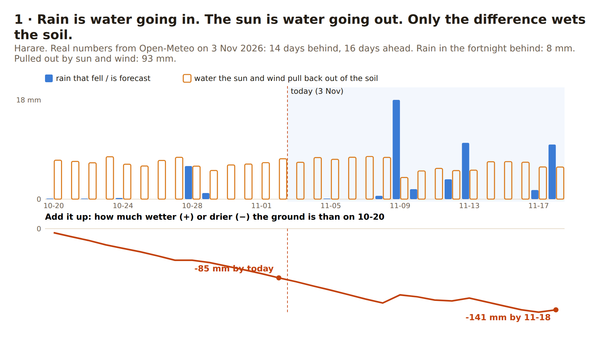
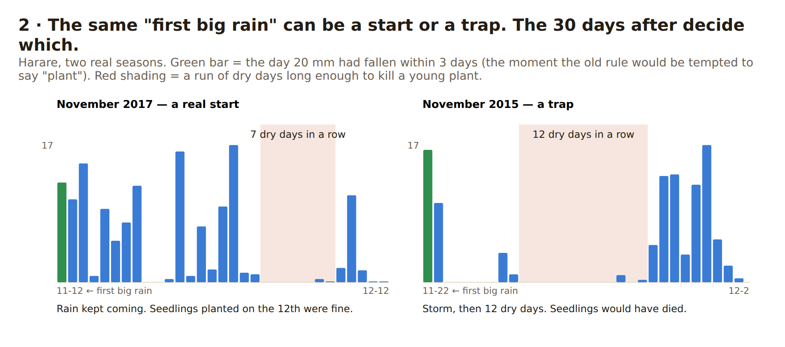
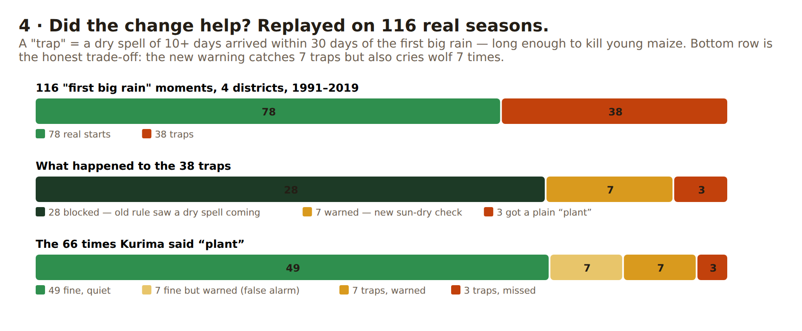
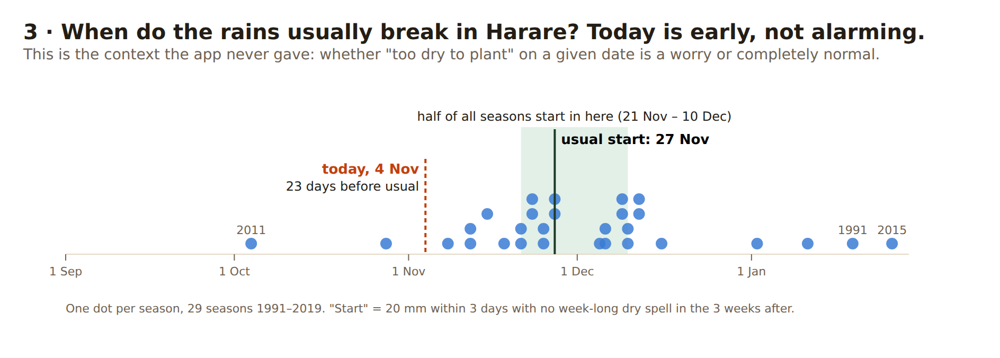

# Kurima, explained from scratch

For a developer who has never farmed. No jargon; where a technical word is unavoidable it is
introduced once and then replaced with a plain one. Every chart uses real Harare data.
Regenerate the pictures with `node scripts/explain-charts.mjs`.

## The one question

A maize farmer has one question at the start of the season: **"If I put seed in the ground
today, will the plant survive?"** Everything Kurima does serves that question and nothing else.

Why it is hard: a seedling has tiny roots that reach only the top few centimetres of soil. That
layer dries out in days. If it stays dry for about ten days in a row, the seedling dies. The
farmer then has to buy seed again, plant again, and the crop that finally grows has a shorter
season. People call this a **false start**, and it is the main way a season is lost at planting.

So the question splits in two:

1. Is the top of the soil wet enough *right now* for seed to sprout? (Look at recent rain.)
2. Will it *stay* wet for the next couple of weeks while the roots grow down? (Look at the forecast.)

## What Kurima looked at before yesterday

Only rain. "Has 20 mm fallen in the last 3 days? Is there a week with no rain coming up?" That
is a reasonable rule and, as it turns out, a fairly good one. But rain is only water going
**in**. Nobody was counting water going **out**.

## What was added: water going out

Every day the sun and wind pull water back out of the soil. Scientists measure this in the same
unit as rain, millimetres per day, so the two subtract directly. The technical name is
*reference evapotranspiration*; from here on it is just **"what the sun takes"**.

In Harare in early November the sun takes about **7 mm a day**. That is the whole insight: if
20 mm of rain falls over three days, but the sun takes 21 mm over those same three days, the
soil is no wetter than before the storm.

Blue bars are rain. Orange outlines are what the sun takes, every single day, whether it rains
or not. The red line adds it up. Over the fortnight before 3 November Harare got 8 mm of rain
and lost 93 mm. The ground was 85 mm drier than two weeks earlier, and nothing in the forecast
turns that around. The old Kurima, looking only at blue bars, could not see this.

## What a trap looks like

Both panels begin on a day when 20 mm had just fallen in Harare, the moment a rain-only rule
is tempted to say "plant". In 2017 the rain kept coming and a crop planted that day did fine.
In 2015 the storm was followed by twelve dry days. Seed planted on 22 November would have
sprouted and then died.

The old rule actually caught 2015: its forecast showed an 8-day dry spell, and 7 is its limit.
That matters. The old rule is better than it looked.

## Did the change actually help? Measured, not assumed.

Instead of trusting the idea, it was replayed over the past. For four Zimbabwe districts and
every season from 1991 to 2019, find the first "20 mm in 3 days" moment, ask what the old rule
and the new check would have said, then look at the next 30 days to see whether a killing dry
spell arrived. 116 moments in all.

Read the bottom row left to right. Of 66 times the rule said "plant": 49 were fine and the new
check stayed quiet. 7 were fine but the new check worried anyway, a false alarm. 7 were traps
and the new check warned. 3 were traps and nothing warned.

**So the new check catches 7 of 10 traps, but cries wolf 7 times.** That is why it was made a
*warning* ("conditions are marginal") and not a *stop sign*. Had it been a stop sign, farmers
would have missed 7 good planting windows to avoid 7 bad ones. Not a trade worth forcing on
anyone. Overall, of 38 traps, 28 are blocked by the old rule, 7 more get a warning, 3 slip through.

Two things this test caught that would otherwise have shipped:

- The first version used a fixed "−40 mm" cut-off. It looked excellent at Harare, where it was
  chosen, and missed two of three traps at Gwanda, which is hotter and drier. Tuning and
  testing on the same place had hidden that. The check now uses a ratio, rain divided by what
  the sun takes, which travels between climates.
- A mock-up said "soil 36 °C, too hot to sow". That number was the surface at midday. At seed
  depth, averaged over the day, the soil across all 116 moments was 13.5–28.9 °C. Fine. The
  claim was dropped; the check stays for cooler, higher places.

## The context the app never gave

Each dot is one season's start. Half of Harare's seasons begin between 21 November and
10 December. Today, 4 November, is 23 days before the usual start. So "too dry to plant" on
4 November is not a warning, it is Tuesday. Kurima currently says "too dry" without this, and a
farmer cannot tell routine from alarming. This chart is Stage 2 of the build order, and it needs
no new data, only the history the app already downloads.

## A day in the life, 4 November 2026, Harare

Tendai opens Kurima. Here is each line on the Today screen and what it is for.

| What Tendai sees | What it means in plain words | How much it matters |
|---|---|---|
| **Wait a little** | Not yet. Soil is dry and nothing in the next 16 days changes that. | The answer. Everything else explains it. |
| *Only 7.1 mm in the last 3 days, below the 20 mm needed* | The top of the soil is not wet enough for seed to sprout. | High: the first half of the question. |
| *Around 20 mm is forecast within 3 days. Wait for it to fall.* | A storm is coming on the 9th; do not plant on a promise. | High: forecast rain is not rain. |
| **Conditions are marginal** — *46 mm of rain forecast but 101 mm lost to sun* | Even after that storm the ground is drying faster than it wets. | Medium: a warning, not a veto; right 7 times in 10. |
| *−55 mm, rain minus what the sun takes, ahead* | The number behind that warning. | Medium: the same fact as a figure. |
| *6 days longest dry run ahead* | No killing dry spell in the forecast. The rule's main safety check. | High: this check blocked 28 of 38 traps. |
| *Forecast issued today* | How old the numbers are. After two days the answer is hidden. | High for trust; it stops a stale "plant" being shown offline. |
| *31% soil moisture (9–27 cm)* | Water in the layer below the seed. | Low today: no context for what 31% means. Candidate for cutting or explaining. |
| Season tab: *Leaning close to normal* | The 3-month model does not expect an unusually dry or wet season. | Low to medium: direction only; the percentages were removed because they were not real probabilities. |
| Season tab: *Normal rainfall here* | What a typical year looks like, month by month. | Medium: it is how Kurima knows November is rainy season and July is not. |

What is missing from that screen that Tendai actually needs: **"the rains here usually start
around 27 November, three weeks away."** Without it, "wait" has no end in sight.

## What Kurima has, and what it does not

| Piece | Status | Plain purpose |
|---|---|---|
| Plant / wait / too dry answer | Have | The one question. |
| Rain in the last 3 days vs a threshold | Have | Is the soil wet enough to sprout seed? |
| Week-long dry spell in the forecast | Have, strongest check | Will the seedling survive its first weeks? |
| What the sun takes, as a warning | Have, since 3 Nov | Is the ground actually wetting up, or just getting rained on? |
| Forecast confidence | Have, since 3 Nov | Is the storm on the 9th likely, or a 20% maybe? |
| Soil temperature | Have, since 3 Nov | Rarely matters in Zimbabwe; kept for cooler places. |
| "Not enough data" rather than a guess | Have | An empty forecast must never read as "no dry spell". |
| Data age, hide when stale | Have | A two-day-old "plant" shown offline is dangerous. |
| Season direction, no fake percentages | Have | Honest about how little a 3-month outlook knows. |
| Monthly normals | Have | How Kurima knows what season it is. |
| Learn screen | Have, since 3 Nov | Explains all of the above to a new farmer. |
| **When the rains usually start here** | Missing, Stage 2 | Turns "wait" into "wait, about three weeks". |
| **Days until planting is likely** | Missing, Stage 2 | A reason to open the app on a given day. |
| This season compared with past ones | Missing, Stage 2 | "Am I behind?" |
| Screen that leads with the answer | Missing, Stage 2 | Today everything has equal weight. |
| Fast, offline climate data for pilot districts | Missing, Stage 3 | The Season tab downloads 198 KB to show 318 bytes of answers. |
| One picker for any place in Africa | Missing, Stage 3 | Districts and search feel like two products. |
| Replay every day of every season, not just the first storm | Missing, Stage 4 | The real test of whether the advice beats a farmer's own judgement. |
| An agronomist's review of the thresholds | Missing, open | Every number was chosen by backtest, not by someone who grows maize. |

## What the charts cannot tell you

- "Trap" is a proxy: ten dry days within thirty. Nobody measured a dead crop.
- Four districts, one crop, 29 seasons, first storm only. Small.
- The ratio was tuned and tested on the same four districts. It should be tuned on some and
  tested on the rest.
- No farmer has planted on Kurima's advice and reported back.

See [../validation.md](../validation.md) for the full account.
